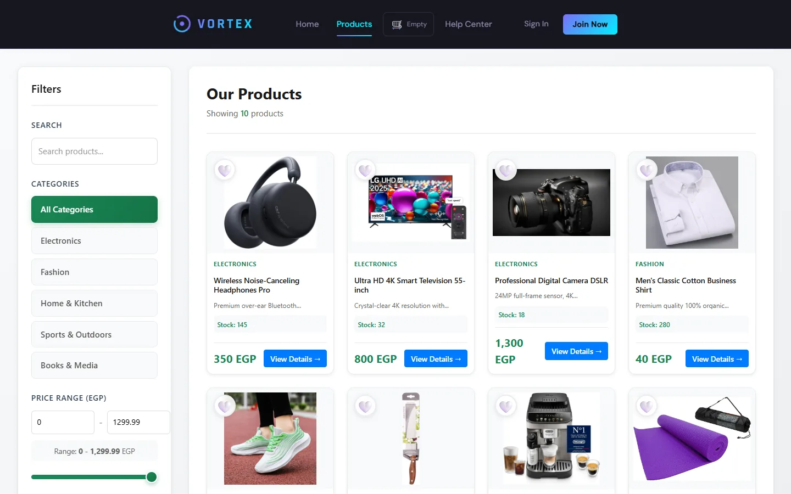
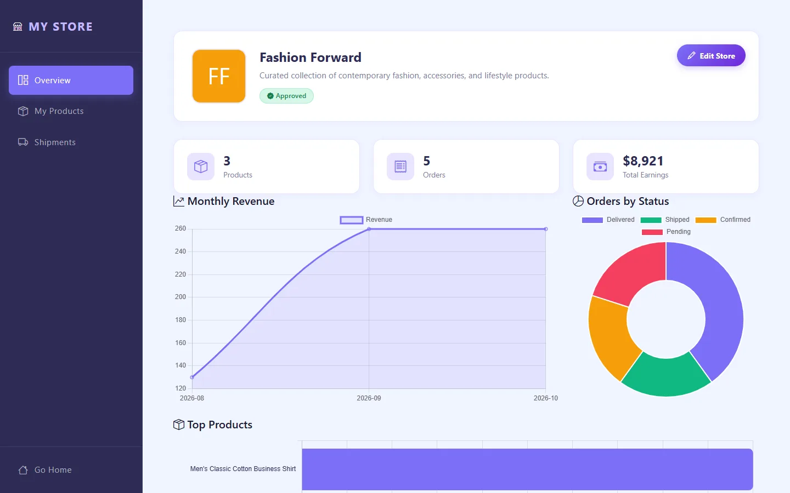
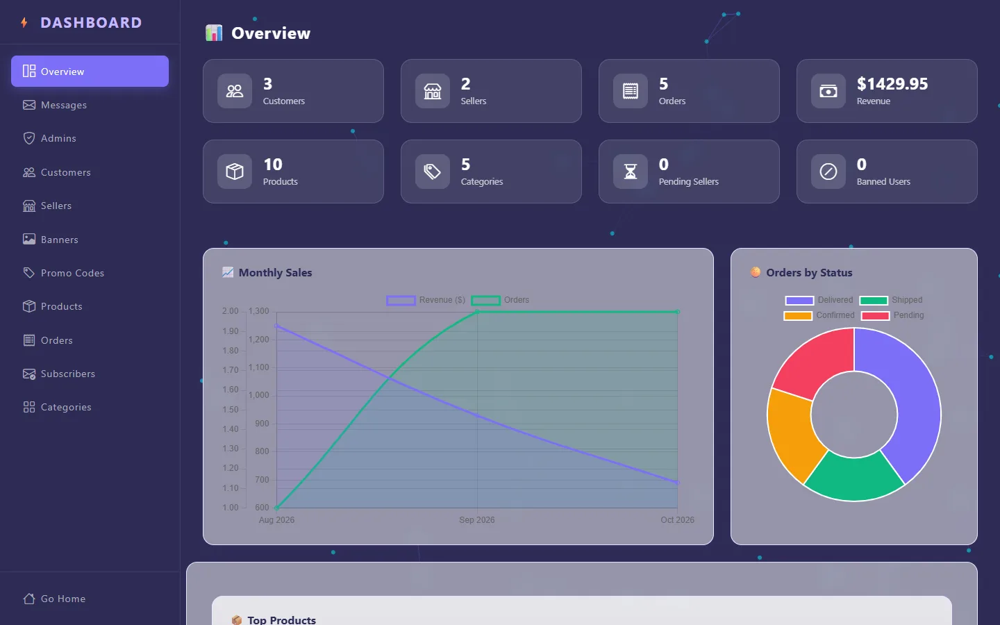
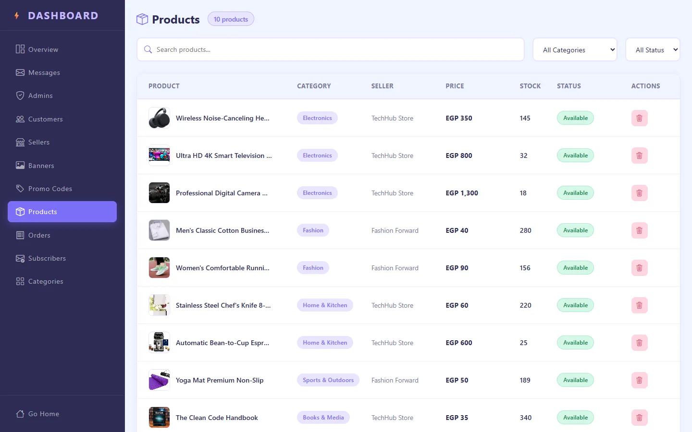

# Vortex E-Commerce Platform

> A full-stack e-commerce platform built with Angular 21 and ASP.NET Core, featuring real-time notifications, role-based dashboards, and a complete shopping experience.

---

## Screenshots

Captured from a local run with seed data. The full write-up is on [my portfolio](https://kandeel11.github.io/#vortex).

<table>
<tr><td width="50%"><br/><sub>The shop: category and price filters over products from two seller stores.</sub></td><td width="50%"><br/><sub>A seller’s dashboard: monthly revenue, orders by status and top products.</sub></td></tr>
<tr><td width="50%"><br/><sub>Admin overview: customers, sellers, orders and revenue across the whole platform.</sub></td><td width="50%"><br/><sub>Admin product table across every seller, with stock and status.</sub></td></tr>
</table>

## Tech Stack

**Frontend**
- Angular 21 (Standalone Components, Signals, Reactive Forms)
- Bootstrap 5 + ng-bootstrap v20
- Chart.js via ng2-charts
- tsParticles
- Microsoft SignalR Client

**Backend**
- ASP.NET Core (.NET 10)
- Entity Framework Core + SQL Server
- MediatR (CQRS pattern)
- ASP.NET Identity
- SignalR
- JWT via HttpOnly Cookies
- Google & Facebook OAuth

---

## Features

### Customer
- Browse and filter products by category, price, rating, and search
- Add to cart (guest and authenticated)
- Wishlist management
- Profile management with avatar upload
- Address management
- Change password
- Become a seller
- Order history
- Newsletter subscription
- Help center with FAQ search
- Contact support form

### Seller
- Store overview with earnings, orders, and product performance charts
- Product management (create, edit, soft delete)
- Store profile editing with logo upload
- Seller statistics dashboard

### Admin
- Platform overview with real-time charts
- Customer management (search, filter, ban, restore, delete)
- Seller management (approve, delete)
- Admin account management
- Real-time message inbox via SignalR
- Product management with restore capability
- Banner management (CRUD)
- Category management (CRUD)
- Promo code management
- Newsletter subscribers list

### Authentication
- Email/password registration and login
- Google OAuth
- Facebook OAuth
- Email confirmation flow
- Role-based redirect after login (Admin → Dashboard, Seller → Store, Customer → Home)

---

## Project Structure

```
ECommerce/
├── ECommerce.API/              # Controllers, Hubs, Middleware
├── ECommerce.Application/      # CQRS Commands, Queries, DTOs, Interfaces
├── ECommerce.Domain/           # Entities, Enums
├── ECommerce.Infrastructure/   # DbContext, Repositories, Services
└── ECommerce.Client/           # Angular 21 Frontend
    └── src/app/
        ├── core/               # Services, Guards, Interceptors, Models
        ├── features/           # Feature modules (auth, admin, seller, profile, etc.)
        ├── layouts/            # Layout components (main, auth, admin, seller, profile)
        └── shared/             # Shared components, pipes, validators
```

---

## Getting Started

### Prerequisites
- .NET 10 SDK
- Node.js 20+
- SQL Server
- Angular CLI 21

### Backend Setup

```bash
# Clone the repository
git clone <repository-url>
cd ECommerce

# Update connection string in appsettings.json
"ConnectionStrings": {
  "DefaultConnection": "Server=YOUR_SERVER;Database=VortexDB;Trusted_Connection=True;"
}

# Apply migrations and seed database
dotnet ef database update

# Run the API
dotnet run --project ECommerce.API
```

The API will be available at `https://localhost:7018`

### Frontend Setup

```bash
cd ECommerce.Client

# Install dependencies
npm install

# Start the development server
ng serve
```

The app will be available at `http://localhost:4200`

---

## Seed Accounts

The database seeds the following accounts automatically on first run:

| Role | Email | Password |
|------|-------|----------|
| Admin | admin@vortex.com | Admin@123 |
| Seller | seller@vortex.com | Seller@123 |
| Customer | customer@vortex.com | Customer@123 |

> **Note:** All seed accounts have email confirmation pre-approved.

---

## API Overview

| Group | Base Route | Description |
|-------|-----------|-------------|
| Auth | `/api/auth` | Login, register, OAuth, change password |
| Admin | `/api/admin` | Full platform management |
| User | `/api/user` | Profile management |
| Seller | `/api/seller` | Seller dashboard and products |
| Products | `/api/products` | Product catalog |
| Cart | `/api/cart` | Shopping cart |
| Wishlist | `/api/wishlist` | Wishlist management |
| Orders | `/api/orders` | Order management |
| Category | `/api/category` | Product categories |
| Contact | `/api/contact` | Customer support messages |
| Newsletter | `/api/newsletter` | Newsletter subscriptions |
| Banner | `/api/banner` | Homepage banners |

---

## Real-Time Features

Vortex uses SignalR for real-time communication:

- Admins automatically join the `Admins` group on dashboard load
- When a customer submits a contact message, admins receive an instant toast notification
- Unread message badge updates in real-time without page refresh

---

## Architecture

The backend follows **Clean Architecture** with **CQRS** pattern:

- **Domain** — Entities and business rules
- **Application** — Use cases via MediatR commands and queries
- **Infrastructure** — Database, repositories, external services
- **API** — Controllers, SignalR hubs, middleware

Authentication uses **HttpOnly cookies** for JWT storage, preventing XSS attacks. All API calls are intercepted to handle 401/403 responses automatically.

---

## Secrets

API keys and passwords are not stored in `appsettings.json`. Set them with .NET user secrets before running the API:

```bash
cd ECommerce.API
dotnet user-secrets set "Jwt:Key" "<at least 32 random characters>"
dotnet user-secrets set "StripeSettings:SecretKey" "<Stripe secret key>"
dotnet user-secrets set "StripeSettings:WebhookSecret" "<Stripe webhook signing secret>"
dotnet user-secrets set "PayPalSettings:ClientId" "<PayPal sandbox client id>"
dotnet user-secrets set "PayPalSettings:Secret" "<PayPal sandbox secret>"
dotnet user-secrets set "Authentication:Google:ClientId" "<Google OAuth client id>"
dotnet user-secrets set "Authentication:Google:ClientSecret" "<Google OAuth client secret>"
dotnet user-secrets set "Authentication:Facebook:AppId" "<Facebook app id>"
dotnet user-secrets set "Authentication:Facebook:AppSecret" "<Facebook app secret>"
dotnet user-secrets set "EmailSettings:EmailUsername" "<Gmail address>"
dotnet user-secrets set "EmailSettings:EmailPassword" "<Gmail app password>"
```

`Jwt:Key` is needed for login; the others are needed for payments, social login and email.
## Environment Configuration

Frontend environment (`src/environments/environment.ts`):

```typescript
export const environment = {
  production: false,
  apiUrl: 'https://localhost:7018/api/'
};
```

---

## License

This project is licensed for educational purposes.
